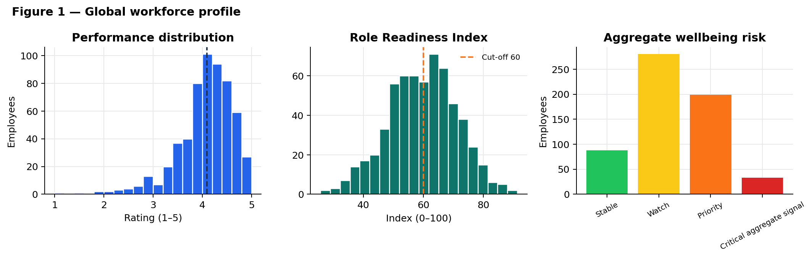
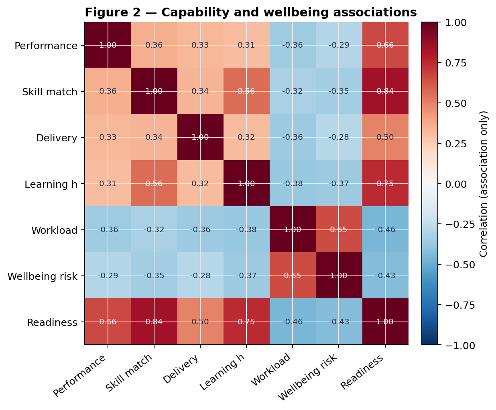
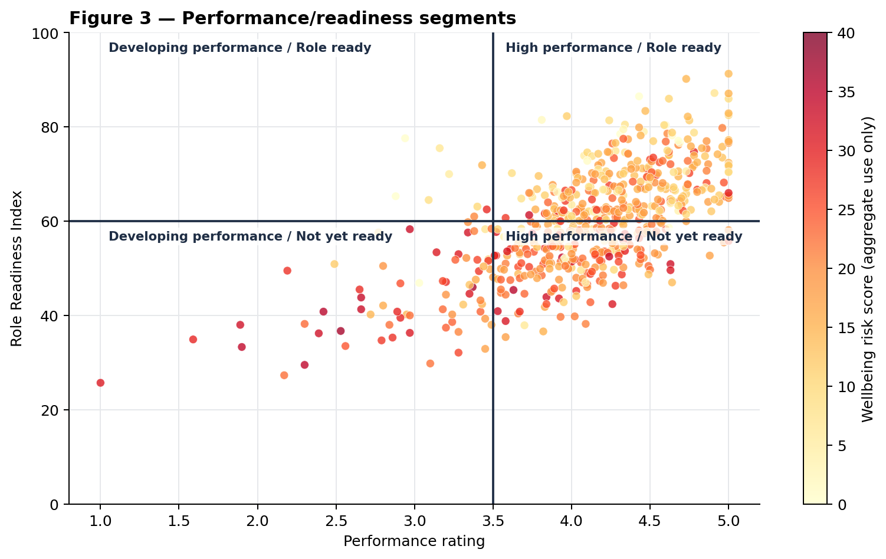
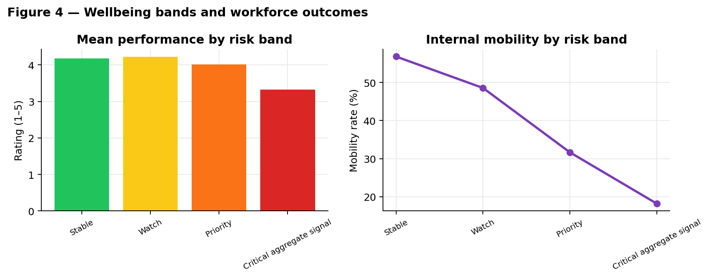
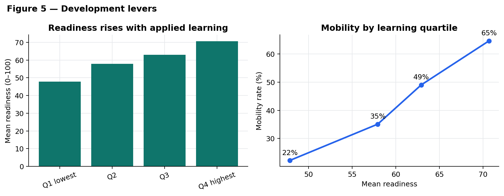
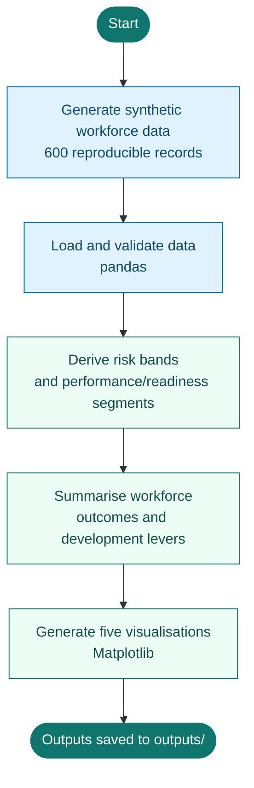

<div align="center">

# MNC Workforce Readiness and Wellbeing Dashboard

**An integrated, privacy-aware workforce analytics case study using reproducible synthetic data.**


</div>

---

## Overview

This project combines performance, capability readiness, learning activity,
workload, wellbeing risk and internal mobility into one analytical pipeline for
a simulated multinational company workforce.

The project is designed as a decision-support demonstration. It does **not**
contain real employee information and must not be used to make promotion,
termination, compensation or hiring decisions.

## Results at a glance

| Metric | Value |
|---|---:|
| Employees analysed | **600** |
| Mean performance rating | **4.09 / 5** |
| Mean Role Readiness Index | **59.7 / 100** |
| Mean wellbeing risk score | **17.9 / 40** |
| Internal mobility rate | **42.5%** |
| Generated visualisations | **5** |

### Workforce segments

| Segment | Employees | Mean readiness | Mobility rate |
|---|---:|---:|---:|
| High performance / Role ready | 302 | 68.6 | 62.6% |
| High performance / Not yet ready | 222 | 52.2 | 24.8% |
| Developing performance / Not yet ready | 67 | 43.6 | 7.5% |
| Developing performance / Role ready | 9 | 67.9 | 66.7% |

> **Interpretation note:** These results are illustrative patterns from simulated
> data, not claims about a real organisation. Correlation does not prove causation.

## Visualisations

All graphs are generated automatically and saved in [`outputs/`](outputs/).

| | |
|---|---|
| **1. Workforce profile**<br>Performance, readiness and wellbeing distributions<br> | **2. Capability and wellbeing associations**<br>Correlation matrix across analytical indicators<br> |
| **3. Performance/readiness segments**<br>Employee segments coloured by aggregate wellbeing risk<br> | **4. Wellbeing and workforce outcomes**<br>Performance and mobility by wellbeing risk band<br> |

**5. Development levers**

Learning-hour quartiles compared with readiness and internal mobility.



## Key findings

- Most employees are high-performing, but a substantial group is not yet role-ready.
- Role-ready segments show higher internal mobility in this simulated cohort.
- Learning-hour quartiles provide a practical lens for exploring development levers.
- Wellbeing indicators should be reported in aggregate and never treated as clinical diagnoses.
- Workforce decisions require privacy review, fairness testing and human judgement.

## How it works



1. `generate_workforce_data.py` creates the reproducible synthetic dataset using
   random seed `2026`.
2. `analyze_workforce.py` derives wellbeing bands and workforce segments,
   prints summary metrics, and saves five PNG visualisations.
3. The analysis uses aggregate patterns only; individual employee wellbeing data
   should not be exposed in management reports.

## Getting started

### Requirements

- Python 3.10 or later
- NumPy
- pandas
- Matplotlib

### Install and run

```powershell
git clone https://github.com/Jai-76/Data.git
cd Data
python -m pip install -r requirements.txt
python programs\generate_workforce_data.py
python programs\analyze_workforce.py
```

The generated dataset is written to `data\workforce.csv`, and the five graphs
are written to `outputs\`.

## Project structure

```text
Data/
├── programs/
│   ├── generate_workforce_data.py
│   └── analyze_workforce.py
├── data/
│   └── workforce.csv
├── outputs/
│   ├── 01_workforce_profile.png
│   ├── 02_correlation_matrix.png
│   ├── 03_performance_readiness_segments.png
│   ├── 04_wellbeing_outcomes.png
│   └── 05_development_levers.png
├── MNC_Workforce_Readiness_Wellbeing_Analysis.md
├── requirements.txt
└── README.md
```

## Limitations and responsible use

- The data is simulated and the results are illustrative only.
- The Role Readiness Index uses selected weights and must be validated before
  any operational use.
- Wellbeing scores are not medical or clinical diagnoses.
- Small groups should be aggregated to protect employee privacy.
- Real deployment requires approval from HR, Legal, Privacy and employee
  representatives.
- Fairness should be tested across lawful demographic and organisational groups.
- Human review is required for every real workforce decision.

## Further analysis

See the detailed methodology, field definitions, limitations and recommended
next steps in
[`MNC_Workforce_Readiness_Wellbeing_Analysis.md`](MNC_Workforce_Readiness_Wellbeing_Analysis.md).
